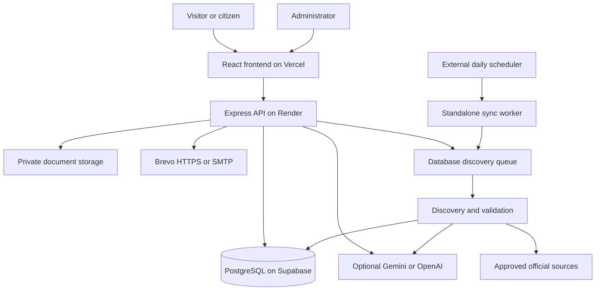
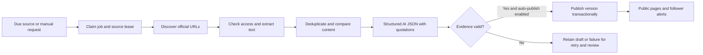

# JANASEVA AI

**India-wide government information, official-source explanations, and a personal citizen workspace.**

JANASEVA AI helps citizens find relevant government schemes, understand requirements, save useful results, and open official application portals. It combines public search, an AI-assisted question interface, personal preparation tracking, and administration of sources and discovery jobs.

Certificate services have a separate public section at `/certificates`, with state, certificate-type and issuing-department filters. Published income, caste, birth, residence and other certificate services appear there automatically from the existing catalog. Cards and details show verified fees, processing times, documents and official application links. Certificate records are separated from the scheme listing; existing `/schemes/:id` certificate links redirect to `/certificates/:id` and retain their account save flow. This presentation change requires no migration or new environment variables and adds no placeholder production records.

The Certificates page includes **27 categories, 41 entries and 16 official-source guides**, with links to all 36 states/UTs. Selecting a state now loads the matching requirements, instead of changing only a government homepage link. Available guides cover national UDID/Jeevan Pramaan services, APSeva certificates, Telangana income, Delhi income/domicile, Goa income/birth, and explicitly scoped Tumakuru/Satara income procedures. Document lists, documented fees, service targets, application instructions and field-level source links appear where supported. District requirements require explicit district selection; source conflicts remain visible. Types awaiting local evidence are separated from default results. The frontend directory remains usable during catalog outages; live published records are linked separately so subsequent ingestion can add guidance without a redeploy. See [coverage, sources and verification](docs/certificates.md).

The shared catalogue also supports citizen services, public notices, recruitment/exams/results, rules and notifications, directories, helplines, grievance/RTI guidance, scheme updates, public events and official FAQs. Each type has the appropriate facts and actions: a hearing is not displayed as a new pension scheme, and a meeting does not receive an application button. See the [government information expansion and verification report](docs/government-records.md) for the implementation, tested official sources and production setup status.

Missing scheme details now use field-specific official-source enrichment and a resumable backfill queue. Claims retain the actual source URL, quotation, source version and fingerprint; reviewed values survive reruns. See the [scheme enrichment report](docs/scheme-enrichment.md) for the root cause, real CSSS before/after, migration, commands and remaining production setup. The hosted CSSS record was backfilled; the other 33 records remain pending in the resumable queue, including retry states, rather than being represented as complete.

The broader vision is international scheme discovery. **The current implementation focuses on India**, including Central and State/UT sources. This is a general scheme finder, not a college-only scholarship website. A retained PM-USP CSSS workflow separately demonstrates scholarship screening and application preparation against a local mock portal.

## Contents

- [Problem and scope](#problem-and-scope)
- [Features and roles](#features-and-roles)
- [Technology stack](#technology-stack)
- [Architecture and application flows](#architecture-and-application-flows)
- [Official sources and coverage](#official-sources-and-coverage)
- [Frontend routes and backend API](#frontend-routes-and-backend-api)
- [Database and migrations](#database-and-migrations)
- [Repository structure](#repository-structure)
- [Local setup from scratch](#local-setup-from-scratch)
- [Environment configuration](#environment-configuration)
- [Production deployment](#production-deployment)
- [Automatic discovery and scheduling](#automatic-discovery-and-scheduling)
- [Testing and verification](#testing-and-verification)
- [Troubleshooting](#troubleshooting)
- [Academic contribution and limitations](#academic-contribution-and-limitations)
- [Further documentation](#further-documentation)

## Problem and scope

Government scheme information is distributed across ministry, state, department, district, and municipal portals. Citizens can struggle to discover relevant programs, interpret eligibility rules, or distinguish current application windows from old announcements.

JANASEVA AI brings published information into a searchable catalog, retains official evidence, and supports application preparation through a personal dashboard. Search categories include education, agriculture, health, housing, employment, finance, and social welfare as records become available.

The platform does not sanction benefits or guarantee eligibility. Issuing authorities make those decisions. Citizens follow official application links; only the separate mock-portal demonstration automates submission.

## Features and roles

| Role | Capabilities |
| --- | --- |
| Visitor | Search published schemes, filter results, read details, ask the public assistant, and follow official links. |
| Pending regular account | Confirm email or request another verification message; ordinary account sessions are withheld until verification. |
| Verified regular user | Personal dashboard, optional profile, explained recommendations, saved schemes, verified deadlines, checklists, self-assessments, and in-app publication alerts. |
| Administrator | Manage schemes/sources, resolve reviews, inspect discovery, invite administrators, view account status, and inspect audit history. |

### Citizen features

- Detail pages explain overview, benefits, eligibility, documents, application instructions, dates, official evidence, and verification metadata.
- Missing facts remain unknown and display **“Not specified in the official source”** where appropriate.
- Recommendations explain text, category, jurisdiction, or occupation matches. They are candidates to check, not eligibility decisions.
- Saves and checklist progress belong to each signed-in account; duplicate saves are prevented.
- Followers can receive in-app publication alerts. Scheme-change email/push alerts are not configured.
- Personal preparation drafts prefill confirmed account/profile details, stay editable, and can be copied after review. No unsupported external government submission is performed.
- Browsing/search are public; saving and other personal actions require login.

### Administrative features

- Import official URLs or supported official PDFs, retaining source text for inspection.
- Automatically publish validated official-source imports when `SCHEME_CATALOG_AUTO_PUBLISH=true`.
- Keep conflicting, incomplete, or unsupported evidence in retry/review state without replacing the previous published version.
- Require administrator review for citizen-submitted notices.
- Enqueue **Sync now** with durable progress and overlapping-run protection.
- Inspect health, coverage gaps, added/changed/skipped/failed/published counts, revisions, and audit events.

## Technology stack

| Layer | Technologies | How they are used |
| --- | --- | --- |
| Frontend | React 19, TypeScript, Vite | Typed components/state, development server, production static builds. |
| UI/navigation | Tailwind CSS, React Router, Lucide, Recharts | Responsive layouts, protected/public routes, icons, dashboard charts. |
| Forms/HTTP | React Hook Form, Zod, Axios | Form validation, API calls, bearer-session headers, error handling. |
| Backend | Node.js, Express 5, TypeScript | REST APIs, authorization, extraction, AI integration, jobs, guided workflows. |
| Hosted database | PostgreSQL on Supabase, `pg` | Records, transactions, constraints, sessions, version history, queue leases. |
| Local database | PGlite with vector extension | Embedded PostgreSQL storage without hosted credentials. |
| Private files | Supabase Storage; local filesystem in development | Applicant documents and workflow artifacts accessed through the backend. |
| AI | Gemini by default; OpenAI supported | Optional intent classification, selection from retrieved scheme IDs, structured descriptions. |
| Policy retrieval | Text matching, optional embeddings and pgvector | Retrieve guideline passages; optional 768-dimensional embeddings support cosine-distance retrieval after indexing. |
| Discovery search | Tavily; Brave alternative | Discover official candidate URLs. Tavily takes precedence when both keys exist. |
| Extraction | Cheerio, `pdf-parse` | Deterministically extract HTML links/text and PDF text before AI processing. |
| OCR | Tesseract.js with English data | Extract supported applicant fields from PNG/JPEG images in the retained workflow. |
| Fetch controls | `robots-parser`, host allowlist, bounded requests | Access checks, redirect checks, public-host restrictions, download limits/timeouts. |
| Authentication | bcryptjs, JWT, database sessions, Node crypto | Password hashing, signed bearer tokens, revocation, random hash-only email tokens. |
| Email | Brevo HTTPS API or Nodemailer SMTP | Verification, recovery, administrator invitations. |
| API controls | Helmet, CORS, express-rate-limit, Zod | Headers, allowed origins, throttling, request schemas, AI-output validation. |
| Browser automation | Playwright | Browser tests and approval-based mock-portal application demonstration. |
| Hosting/operations | Vercel, Render, Docker, GitHub Actions | Static frontend, API container, independent discovery worker/schedule. |
| Quality checks | TypeScript, ESLint, Node test runner, Playwright | Type/static checks, integration tests, browser verification. |

**Retrieval scope:** public scheme ranking currently uses names, aliases, keywords, categories, and location, followed by optional model selection. Vector retrieval exists for indexed policy passages; the entire scheme catalog is not a semantic vector index. The project does not train a custom model or Random Forest classifier.

## Architecture and application flows



### 1. Public search and AI assistant

1. A visitor enters a name or natural-language question.
2. The API retrieves published candidates using text, aliases, category, and coverage.
3. If configured, the model selects relevant IDs from those candidates rather than inventing schemes.
4. The backend constructs cards and source-based requirements, document information, or date answers. AI failure falls back to catalog matching.
5. Missing, stale, or geographically incomplete results can request rate-limited discovery and known-source rechecks. Checks may finish later; asking does not guarantee an immediate verified match.
6. The citizen opens details and an available official application link. Unclear current dates remain unverified.

Public answers do not retain server-side conversation history. Signed-in conversations are stored with ownership checks. A short follow-up may ask for a missing state when it changes scholarship results.

### 2. Official source to published scheme



- Connectors support documents, supported listings, PIB RSS, and official-domain search. Registering an API/feed does not create its parser; a supported connector is required before activation.
- Imports retain original title, official identifier where available, source/application links, extracted text, timestamps, and versions.
- Canonical source URLs or identifiers prevent duplicates. Content comparison skips regeneration of unchanged successful descriptions.
- The model treats source material as untrusted evidence and returns validated JSON with quotations. Numbers, dates, units, conditions, and exceptions must be preserved. Search snippets are not publication evidence.
- Sections include overview, who can apply, benefits, eligibility, documents, application steps, dates, and contacts when supplied. Empty arrays represent missing information.
- Status is `announced`, `open`, `closed`, `rolling`, or `unknown`. Current application status requires appropriate application-portal evidence. A past deadline alone does not establish closure.
- Publication changes a database pointer in a transaction, retaining older versions. Failed fetch/generation/validation preserves the public version.
- Catalog responses use `Cache-Control: no-store`; published changes appear on the next request without rebuilding the frontend.

### 3. Authentication and recovery

1. Registration normalizes email, enforces uniqueness, hashes the password, and creates a pending regular account. Clients cannot assign roles.
2. The backend sends a random verification token and stores only its hash. Replacement invalidates earlier links.
3. An explicit confirmation consumes the token and verifies the account atomically. Opening an email link alone does not consume it.
4. Login creates a signed JWT associated with a database session. Protected pages restore the backend session through `/auth/me` before deciding access.
5. Regular users go to `/dashboard`; administrators go to `/admin`. Validated internal destinations can restore a protected Save action.
6. Personal APIs derive account identity from the session. Logout/account switching clears account-specific client state.
7. Reset uses a separate short-lived single-use token. Success replaces the password hash and revokes sessions and outstanding reset tokens.

**Default admin exception:** `Adminmail` and `AdminPass` are server-only bootstrap credentials. This configured account logs in without mailbox verification; its email-shaped identifier need not have a real inbox. No fake verification timestamp is written. Credential rotation invalidates bootstrap sessions. Invited administrators must confirm the email invitation and set a password. Regular recovery does not change `AdminPass`.

### 4. Personal dashboard

The dashboard loads the current account's profile, saves, checklists, and alerts. Profile setup is optional. Recommendations explain jurisdiction and occupation/category evidence; age/income preferences do not establish full eligibility. Deadline cards require explicit application-date evidence and an unambiguous date. Publication changes can invalidate older self-assessments so users review new conditions.

### 5. Retained guided application demo

The PM-USP CSSS demo retrieves scoped policy evidence, performs deterministic screening, extracts supported document fields, and prepares a dossier. One approval authorizes fill-only Playwright execution; a second authorizes submission to the signed, loopback-only mock portal. Completion requires a receipt. This is separate from general discovery and is not live government-form automation.

## Official sources and coverage

| Source | Purpose | Access/implementation position |
| --- | --- | --- |
| myScheme and State/UT directory | Central and State/UT discovery | Registry candidates; automation requires authorization and supported API integration. |
| India.gov.in | Additional listings/official links | Candidate pending supported access and connector verification. |
| IGOD | Official ministry/state/department publishers | Directory candidate; new hosts need approval. |
| DBT Bharat | Central DBT schemes by ministry | Registry candidate for approved integration. |
| National Scholarship Portal | Listings, cycles, announcements | Candidates plus reviewed catalog records; historical dates are not confirmed current deadlines. |
| JanSamarth / Financial Services | Credit and loan schemes | Candidate for supported official links/access. |
| PIB | New/revised scheme announcements | Implemented RSS discovery; a news mention alone can be insufficient. |
| AP NTR Bharosa pension order | Official pension PDF | Implemented document connector; conflicting older amounts require reconciliation. |
| Approved Central/State/UT publishers | India-wide coverage | Search rotates publishers/topics, including departments and selected district hosts. |

Registry records track jurisdiction, department, access method, notes, and health. Fetching uses approved exact hosts and robots/redirect checks, not unrestricted crawling. Official PDF upload with an original URL supports review when automatic access is unavailable.

No source webhook connector is verified. All 36 State/UT filter options exist, but imported records depend on access, indexing, extraction, and validation. District/village coverage can remain incomplete. [Source operations](docs/government-schemes.md) records historical source checks, not guarantees of current availability.

## Frontend routes and backend API

### Frontend

| Routes | Access and purpose |
| --- | --- |
| `/` | Public home/search. |
| `/schemes`, `/schemes/:id` | Public listing and stable ID-based detail pages. |
| `/certificates`, `/certificates/:id` | Separate certificate services, filters, documents, fees, processing times and official application links. |
| `/certificates/guides/:slug` | Public reference guides with scoped evidence, application navigation and state portal links. |
| `/ask` | Public assistant; personal actions require login. `/assistant` redirects here. |
| `/login`, `/register` | Login/public registration. |
| `/check-email`, `/verify-email` | Instructions, explicit verification, resend. |
| `/forgot-password`, `/reset-password` | Recovery. |
| `/accept-invitation` | Admin invitation acceptance. |
| `/dashboard` | Personal overview, recommendations, saves, deadlines. |
| `/dashboard/saved`, `/dashboard/checklists`, `/dashboard/profile` | Saves, progress, optional preferences. |
| `/dashboard/drafts`, `/dashboard/drafts/:id` | Owner-only, profile-prefilled preparation drafts and review/copy actions. |
| `/dashboard/notices`, `/my-schemes` | Notices and retained assessments/following/alerts. |
| `/admin` | Admin overview. |
| `/admin/schemes`, `/admin/review`, `/admin/review/notices` | Management and review. |
| `/admin/sources`, `/admin/discovery` | Sources, health/coverage, queue/run history. |
| `/admin/users`, `/admin/audit` | Accounts, invitations, audit. |
| `/documents`, `/applications`, `/applications/:id` | Protected retained workflow. |
| `/applications/:id/monitor`, `/tracking`, `/tracking/:id` | Protected browser monitoring/tracking. |

Backend authorization is independent of UI guards. Regular users opening admin pages receive access denied. Legacy `/schemes/admin` and `/schemes/monitor` redirect appropriately. Existing IDs/URLs are preserved.

### API groups

All paths are relative to `/api/v1`.

| Group | Purpose |
| --- | --- |
| `/health`, `/ready` | Process health and database readiness. |
| `/auth` | Registration, login, `/me`, logout, verification, recovery, invitations. |
| `/schemes` | Public catalog, locations, details, rechecks. |
| `/assistant`, `/policy`, `/eligibility` | Questions, evidence, retained screening. |
| `/citizen-schemes` | Owner-scoped profile, saves/watches, progress, assessments, alerts. |
| `/admin` | Overview, lists, history, review, discovery, users, audit. |
| `/scheme-catalog-admin` | Protected imports, versions, sources. |
| `/scheme-monitor` | Notices/review. |
| `/documents`, `/applications`, `/browser`, `/tracking` | Protected guided workflows. |

See [API documentation](docs/api-specification.md) and route modules for contracts. The API root `/` intentionally has no website page.

## Database and migrations

Supabase hosts PostgreSQL and private Storage. **Login uses custom Express authentication, not Supabase Auth.** Browser clients never receive the service-role key or direct private-table access.

| Area | Main tables |
| --- | --- |
| Accounts | `users`, `citizen_sessions`, `auth_email_tokens`, `auth_email_limits`, `auth_role_audit` |
| Schemes/evidence | `schemes`, `scheme_catalog_imports`, `scheme_catalog_versions`, `policy_documents`, `document_chunks` |
| Sources/jobs | `scheme_source_registry`, `scheme_catalog_sources`, `scheme_catalog_runs`, `scheme_recheck_requests`, `discovery_requests` |
| Personal | `citizen_scheme_profiles`, `citizen_scheme_watches`, `citizen_scheme_progress`, `citizen_scheme_assessments`, `citizen_scheme_alerts` |
| Preparation/configuration | `citizen_form_drafts`, `catalog_categories`; typed facts/dates live in versioned description JSON. |
| Notices/audit | `scheme_monitor_sources`, `scheme_monitor_items`, `admin_audit` |
| Guided workflow | `applications`, `uploaded_documents`, `eligibility_checks`, `approvals`, `browser_sessions`, `agent_events`, `conversations` |

Migrations `001`–`012` cover schema/security, catalogs, versioning, alerts, finder preferences, admin sessions, email auth, and dashboards. `20261120134249_government_records.sql` adds private preparation drafts, categories, protected human edits and a scoped ingestion role; `20261120142343_ingestion_maintenance.sql` preserves bounded registration cleanup without exposing citizen tables to that role. Hosted applied files are recorded in `janaseva_migrations`, transactionally per file. Use migrations rather than resetting accounts or saved data.

The hosted runner also applies reviewed base-scheme seeds and refreshes reviewed NSP seeds. Seed records do not prove current application windows. Test/demo fixtures must remain in isolated databases, not the production catalog.

## Repository structure

```text
janaseva-ai/
├── frontend/src/
│   ├── pages/                  Public, personal, auth, admin screens
│   ├── components/             Cards, checklists, account menu, route guards
│   ├── contexts/               Session restoration/account state
│   ├── layouts/                Public, personal, admin navigation
│   └── services/               HTTP and safe destination helpers
├── backend/src/
│   ├── ai/providers/           Gemini/OpenAI JSON and embedding adapters
│   ├── modules/catalog/        Discovery, extraction, validation, queue, versions
│   ├── modules/assistant/      Scheme questions/guided conversation
│   ├── modules/auth/           Sessions, mail, admin provisioning
│   ├── modules/citizen/        Personal data/ownership
│   ├── modules/                Schemes, policy, notices, documents, workflow
│   ├── config/                 Environment/database selection
│   ├── tests/                  Backend tests
│   └── run-scheme-sync.ts      Independent worker entry point
├── database/migrations/        Schema changes
├── database/seed/              Reviewed scheme inputs
├── mock-portal/                Local submission demonstration
├── docs/                       Operations, architecture, API, checks
├── .github/workflows/          Daily discovery workflow
├── Dockerfile                  API/browser/mock-portal container
├── Dockerfile.scheme-sync      Discovery container
├── render-scheme-sync.yaml     Daily Render cron Blueprint
└── .env.example                Server configuration template
```

## Local setup from scratch

### 1. Install dependencies

Use Node.js 20.19+ compatible with the frontend toolchain; Node.js 22 is the deployment baseline. Install npm and Git.

```sh
git clone https://github.com/Harshavardhan3011/JANASEVA-AI.git
cd JANASEVA-AI
npm ci
npm ci --prefix backend
npm ci --prefix frontend
npm ci --prefix mock-portal
```

### 2. Configure the environment

Copy `.env.example` to the root `.env`. PowerShell:

```powershell
Copy-Item .env.example .env
```

Keep `NODE_ENV=development` and leave `DATABASE_URL` blank for local PGlite. It initializes migrations/reviewed seeds on startup. Database files, local signing secrets, and private artifacts live under `.data/`. Use one API process per local data directory.

Deterministic search and retained policy lookup work without cloud/AI credentials. Regular verification still needs a mail provider; local development does not bypass it. Configure your own `Adminmail`/`AdminPass` for local admin access. Search discovery needs a search key; AI descriptions need a model key.

### 3. Prepare browser execution

Windows selects installed Chrome, then Edge. If unavailable, or on macOS/Linux:

```sh
cd backend
npx playwright install chromium
cd ..
```

Linux may need `npx playwright install --with-deps chromium`. Use `BROWSER_CHANNEL=bundled` for bundled Chromium on Windows or `chrome` for installed Chrome.

### 4. Start services

```sh
npm run dev
```

| Service | Address |
| --- | --- |
| Frontend | `http://localhost:5173` |
| API | `http://localhost:3001/api/v1` |
| Readiness | `http://localhost:3001/api/v1/ready` |
| Mock portal | `http://127.0.0.1:3002` |

Vite proxies `/api` locally. Separate commands are `npm run dev:frontend`, `npm run dev:backend`, and `npm run dev:portal`.

## Environment configuration

Root `.env` supplies backend/migration settings. Hosted values belong in deployment secrets; the frontend receives only its public API URL.

| Variables | Purpose |
| --- | --- |
| `NODE_ENV`, `PORT`, `FRONTEND_URL` | Mode, listener port, allowed frontend origin. |
| `DATABASE_URL` | Hosted PostgreSQL; blank for local embedded storage. |
| `INGESTION_DATABASE_URL` | Optional dedicated worker login; worker pools use `SET ROLE janaseva_ingestor` and cannot read accounts or citizen drafts. |
| `SUPABASE_URL`, `SUPABASE_SERVICE_ROLE_KEY`, `STORAGE_BUCKET` | Server-only private Storage; bucket defaults to `documents`. |
| `JWT_SECRET`, `PORTAL_SECRET` | Independent production web secrets, at least 32 characters; generated locally if absent. |
| `Adminmail`, `AdminPass` | Exact case-sensitive default-admin setting names. |
| `LLM_PROVIDER`, `LLM_API_KEY`, `LLM_MODEL` | `gemini` or `openai`, key, optional model override. |
| `EMBEDDING_PROVIDER`, `EMBEDDING_API_KEY`, `EMBEDDING_MODEL` | Optional policy embeddings; run `npm run policy:index` after setup/model changes. |
| `TAVILY_API_KEY`, `SCHEME_SEARCH_API_KEY` | Tavily or alternative Brave discovery. |
| `SCHEME_CATALOG_ENABLED` | In-process scheduler; default `true`. Disable scheduled polling on a sleeping web API if an independent worker owns it. |
| `SCHEME_CATALOG_AUTO_PUBLISH` | Auto-publish validated official imports; default `true`. |
| `SCHEME_SYNC_WORKER` | `true` for standalone production workers, which require `DATABASE_URL` without web-only secrets. |
| `SCHEME_MONITOR_ENABLED`, `SCHEME_MONITOR_KEY`, `POLICY_INGEST_KEY` | Notice/retained operational settings. Keys do not replace admin-session authorization. |
| `BREVO_API_KEY`, `SMTP_FROM`, `APP_PUBLIC_URL` | HTTPS email, verified sender, frontend URL for links. |
| `SMTP_HOST`, `SMTP_PORT`, `SMTP_SECURE`, `SMTP_USER`, `SMTP_PASS` | SMTP alternative when no Brevo API key exists. |
| `EMAIL_VERIFY_TTL_MINUTES`, `PASSWORD_RESET_TTL_MINUTES` | Expiry defaults: 60 and 30 minutes. |
| `AUTH_EMAIL_COOLDOWN_SECONDS`, `PENDING_REGISTRATION_DAYS` | Cooldown/abandoned-new-account retention: 60 seconds/30 days. |
| `TRUST_PROXY_HOPS` | Trusted proxy depth for IP throttling. Render defaults to one unless overridden; set `1` there instead of the template's local `0`. |
| `BROWSER_CHANNEL`, `BROWSER_HEADLESS`, `BROWSER_TIMEOUT`, `OCR_LANG_PATH` | Browser/OCR configuration. |
| `MOCK_PORTAL_URL`, `MOCK_PORTAL_PORT` | Loopback demonstration portal. |

When `BREVO_API_KEY` exists, mail uses HTTPS without SMTP fallback on failure. API and SMTP keys are different. Use an authorized `SMTP_FROM`; startup readiness proves authentication, not inbox delivery. See [email setup](docs/email-auth.md) for TLS, sender DNS, cooldowns, and inbox tests.

Never commit `.env`, expose server secrets as `VITE_*`, log tokens/passwords, or disable certificate verification.

## Production deployment

### 1. Hosted database

Install backend dependencies, configure the intended TLS-enabled `DATABASE_URL`, then run from the root:

```sh
npm run db:migrate
```

This applies the ordered migrations, including `20261120134249_government_records.sql`, and reviewed seeds. The government-record migration has already been applied to the existing hosted project; other environments still need it. Local PGlite initializes on startup instead. Use the provider-supported connection string and trusted certificate chain; percent-encode special characters in passwords.

### 2. Render API

Use the root `Dockerfile`. It builds the backend, installs Chromium, and runs `node backend/dist/server.js`. Configure production database/Storage, signing secrets, frontend origin, admin credentials, and required mail/AI/search settings.

Health-check path: `/api/v1/ready`. The API uses platform `PORT`. Keep the mock portal on loopback. Persistent `/app/.data` is necessary to retain mock receipt files across restarts; hosted citizen records use PostgreSQL/private Storage.

### 3. Vercel frontend

| Setting | Value |
| --- | --- |
| Root directory | `frontend` |
| Framework | Vite |
| Build | `npm run build` |
| Output | `dist` |
| Environment | `VITE_API_URL=https://YOUR-API-HOST/api/v1` |

Set API `FRONTEND_URL` and `APP_PUBLIC_URL` to the actual frontend origin. `frontend/vercel.json` supplies SPA rewrites for direct refreshes. Vite embeds environment values at build time: rebuild/redeploy after changing the API URL.

### 4. Deployment checks

Check readiness, signed-out browsing, real verification email arrival, login/saves, reset arrival and revocation, default-admin login, and direct subroute refreshes. A successful container deployment does not prove these flows passed.

## Automatic discovery and scheduling

The API scheduler wakes once a minute while running and checks due sources. Each source has its own interval. A sleeping/stopped web API cannot provide unattended polling; use an independent worker sharing the hosted database.

### Option A: Render cron

`render-scheme-sync.yaml` uses `Dockerfile.scheme-sync` at **02:00 UTC daily (07:30 IST)**. Supply database, model, and search keys. The worker processes due sources and exits without an HTTP server. Keep automatic publication enabled if desired.

### Option B: GitHub Actions

`.github/workflows/scheme-sync.yml` has the same daily schedule and manual **Run workflow**. Configure repository Actions secrets:

- `JANASEVA_DATABASE_URL`
- `JANASEVA_INGESTION_DATABASE_URL` (optional dedicated worker connection, alternative to the above)
- `JANASEVA_LLM_API_KEY`
- `JANASEVA_TAVILY_API_KEY`, or `JANASEVA_SCHEME_SEARCH_API_KEY` for Brave

Optional repository variable `JANASEVA_LLM_PROVIDER` defaults to `gemini`. Enable and manually run the workflow before relying on its schedule. Choose one primary external scheduler to avoid redundant work; queue/source leases still protect concurrent claims.

### Run the next sync

```sh
# Hosted DATABASE_URL and backend dependencies required:
npm run schemes:sync

# Inside an already built worker container:
node backend/dist/run-scheme-sync.js
```

The npm command uses the TypeScript entry point and processes due work. Admin **Sync now** also makes enabled, available sources due. The restricted standalone worker has no direct account access; it preserves abandoned-registration cleanup through a bounded private maintenance function.

Read-only production checks found scheduled GitHub run `44712189875` failed because its database secret was missing. Configure `JANASEVA_DATABASE_URL` or `JANASEVA_INGESTION_DATABASE_URL` before relying on unattended discovery. The current Render workspace has no dedicated JANASEVA cron service. Details and evidence are in [the expansion report](docs/government-records.md).

Queue uniqueness, source leases, heartbeats, and expired-lease recovery prevent overlap/recover interrupted work. Queue interruptions retry up to three attempts; source/generation failures retain separate retry state. A completed request may contain failed sources: inspect both request state and per-source results in `/admin/discovery`.

**Effective frequency depends on external scheduling and source intervals together.** A daily worker does not provide 15-minute checking. Faster execution needs a supported schedule, permitted source access, and provider capacity. To prove production operation, retain a scheduled run, its source/version evidence, and the resulting public page from an interval without visitors. This README does not claim a production scheduled run was demonstrated.

## Testing and verification

```sh
npm run typecheck
npm run lint
npm test
npm run build
npm run test:auth-ui
npm run test:records-ui
```

Backend tests cover pending accounts, expired/single-use tokens, reset revocation, role injection, default-admin exemption, invitations, ownership, saves, queue concurrency/recovery, revisions, deduplication, outages, screening, and approval-based browser execution.

`test:auth-ui` builds the backend and starts isolated API/Vite instances. It checks forms, verification, saving, reset, account switching, redirects, admin navigation, sync progress, default-admin login/refresh, and mobile layouts. Email is captured locally, not delivered.

`npm run test:ui` runs the broader smoke script; see [testing instructions](docs/testing-guide.md) for service prerequisites. Tests use temporary databases and controlled source/AI fixtures. They do not prove live portal availability, deployed inbox delivery, or an enabled external scheduler.

The government-information increment adds an official-fixture integration test to the existing suite (16 backend tests) and a records browser smoke test. The checks use real captured official text with controlled model responses; they do not establish live model credentials or successful production scheduling. See [the verification report](docs/government-records.md) for results and remaining deployment checks.

## Troubleshooting

| Symptom | Check |
| --- | --- |
| API root returns `Cannot GET /` | API-only host: check `/api/v1/ready`; open the frontend host for the website. |
| Frontend API 404 | Include `/api/v1` in `VITE_API_URL`, deploy matching backend routes, rebuild frontend. |
| Draft save validation error | Complete the named section/item: public wording needs 3–1600 characters and an exact source quotation needs 5–2400. Untouched blank rows are ignored; partial rows must be completed or removed. Missing sections may remain empty. |
| AI generation failed | Retry after checking the reported HTTP status: authentication/permissions, model availability, quota/rate limit, or provider outage. Existing source text and published versions are preserved. |
| Readiness 503 | Database, credentials, migrations, trusted TLS certificates. |
| Missing verification email | Deployed route, credentials, authorized sender, public URL, delivery logs. Authentication and timeout errors are different failures. |
| Resend 429 | Honor countdown/`Retry-After`; email limits persist across redeploys. Check proxy depth if IP buckets are grouped. |
| Default admin asked to verify | Deploy bootstrap-exemption code and use `Adminmail`/`AdminPass`, not public registration. |
| Empty state results | Filters do not create records. Check search keys, source access, rotation, run outcomes, validation. |
| No discovery without visitors | Verify external worker, shared database, successful run history. Sleeping API timers are insufficient. |
| AI unavailable | Catalog search remains usable; descriptions remain retryable and published versions survive. |
| Browser/OCR memory pressure | Inspect usage; avoid simultaneous browser-heavy demos on small instances. Text discovery is separate from Playwright. |

## Academic contribution and limitations

The base paper is [Government Schemes Recommendation with Multi-Language Chatbot Using RAG Vector Search and Conversational AI (IJFMR, 2026)](https://www.ijfmr.com/papers/2026/3/79624.pdf). It identifies automated consumption of live policy changes as future work. JANASEVA AI extends that direction through approved-source discovery, evidence validation, versioned updates, failure preservation, and personal preparation tracking. Login, dashboards, and chatbots alone are not novel research contributions.

Evaluate discovery-to-publication delay, change-detection accuracy, duplicate prevention, consistency with official evidence, search relevance, and account isolation on a documented dataset. Do not report another paper's measurements as this project's results.

Current boundaries:

- India-focused approved sources, not unrestricted worldwide crawling or complete village coverage.
- Registry candidates are not automatically enabled connectors; no verified source webhook.
- Profile preferences do not establish full eligibility; unknown facts stay unknown.
- Catalog ranking is text/category/location based; semantic retrieval is optional and scoped to policy evidence.
- Official imports require validation; citizen submissions require review.
- Provider readiness differs from inbox delivery; schedules need production-run evidence.
- Submission automation is a mock-portal demo, not arbitrary government automation.
- International connectors, multilingual voice assistance, and scheme-change email/push alerts are possible future work rather than current guarantees.

## Further documentation

- [Architecture and retained workflow](docs/architecture.md)
- [Official sources, evidence, publishing](docs/government-schemes.md)
- [Shared government records, autofill, security and verified examples](docs/government-records.md)
- [Role dashboards and scheduler activation](docs/role-dashboards.md)
- [Authentication, Brevo/SMTP, recovery](docs/email-auth.md)
- [Hosted setup](docs/setup-guide.md)
- [API specification](docs/api-specification.md)
- [Testing guide](docs/testing-guide.md)
- [Project progress](PROJECT_PROGRESS.md)

Supporting documents include historical implementation notes. Use this README with the checked-out source and deployed settings for current behavior.
